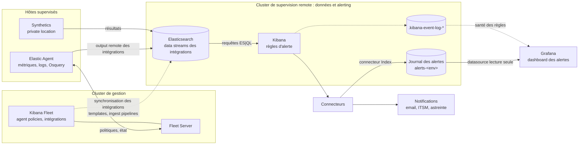
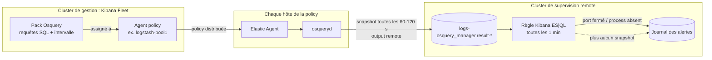

# Rapport de migration : supervision Zabbix vers Elastic Agent et Kibana Alerting

| | |
|---|---|
| **Version** | 0.1 (brouillon) |
| **Date** | 2026-11-11 |
| **Auteur** | [À COMPLÉTER] |
| **Statut** | En rédaction / En relecture / Validé |
| **Diffusion** | [À COMPLÉTER : équipes exploitation, responsables applicatifs, management] |

**Historique des versions**

| Version | Date | Auteur | Modification |
|---|---|---|---|
| 0.1 | 2026-11-11 | [À COMPLÉTER] | Création du document |

> Les passages entre crochets `[À COMPLÉTER]` sont à remplir avec les chiffres et décisions issus du fichier Excel et des tests. Les textes en italique sont des consignes de rédaction, à supprimer dans la version finale.

---

## 1. Synthèse

**[N] alertes Zabbix ont été inventoriées. [X + Y] sont désormais couvertes par des règles Kibana, [~10] ne sont pas migrables et [Z] sont abandonnées.** La supervision peut basculer sur Elastic une fois la période de fonctionnement en parallèle validée et le sort des alertes non migrables décidé.

| Statut | Nombre | % | Dont critiques |
|---|---|---|---|
| Migrée à l'identique | [X1] | [%] | [ ] |
| Migrée avec adaptation | [X2] | [%] | [ ] |
| Remplacée par une autre approche | [X3] | [%] | [ ] |
| **Non migrable** | **[~10]** | [%] | [ ] |
| Abandonnée (obsolète, doublon, jamais déclenchée) | [Z] | [%] | [ ] |
| **Total** | **[N]** | 100 % | [ ] |

**Décisions attendues**

1. Sort de chacune des [~10] alertes non migrables (section 9) : alternative, maintien temporaire de Zabbix, ou acceptation du risque.
2. Validation de la date de bascule : [À COMPLÉTER].
3. Validation du décommissionnement de Zabbix et des agents Zabbix : [À COMPLÉTER].

---

## 2. Contexte et objectifs

**Contexte.** La supervision et l'alerting reposent aujourd'hui sur Zabbix (serveur et Zabbix agent sur [N] hôtes). La plateforme Elastic est déjà utilisée pour [À COMPLÉTER : logs, métriques, Stack Monitoring…]. La migration regroupe collecte, stockage et alerting sur une seule plateforme.

**Objectifs**

| Objectif | Indicateur | Cible |
|---|---|---|
| Couvrir les alertes existantes | Part des alertes Zabbix couvertes ou abandonnées avec justification | [ ] % |
| Ne pas dégrader la détection | Délai entre l'incident et l'alerte | ≤ délai Zabbix actuel |
| Réduire le bruit | Nombre de faux positifs pendant le double run | < Zabbix |
| Supprimer un outil | Zabbix décommissionné | [date] |

---

## 3. Périmètre

**Référentiel.** L'inventaire de départ est le fichier `[nom du fichier].xlsx`, version du [date], fourni par [équipe / personne]. Chaque ligne de ce fichier a un statut dans la matrice de correspondance (section 7 et annexe A).

| Élément | Valeur |
|---|---|
| Hôtes supervisés | [N] |
| Systèmes | [Linux / Windows / équipements réseau…] |
| Templates Zabbix | [liste ou nombre] |
| Triggers (alertes) inventoriés | [N] |
| Media et destinataires | [email, SMS, ITSM, chat…] |

**Hors périmètre**

- Dashboards et graphes Zabbix (traités séparément : [À COMPLÉTER]).
- Historique des métriques Zabbix : non repris.
- [À COMPLÉTER]

---

## 4. Correspondance des concepts Zabbix → Elastic

| Zabbix | Elastic | Remarque |
|---|---|---|
| Zabbix agent | Elastic Agent, géré par Fleet | Un seul agent pour métriques, logs et Osquery |
| Template | Intégration + agent policy | L'agent policy décide quels hôtes collectent quoi |
| Host group | Agent policy, tags | |
| Item | Champ ou métrique dans un data stream | Ex. `system.cpu.total.norm.pct` |
| Trigger (expression) | Règle Kibana (ES\|QL, custom threshold, Synthetics…) | Une règle peut couvrir tous les hôtes à la fois |
| Sévérité | Priorité (P1, P2…) et `severity` | Table de correspondance en section 6 |
| Macro (seuil) | Seuil dans la règle, ou lookup index | |
| Low-level discovery (LLD) | Regroupement dynamique (`STATS … BY`) | Pas de découverte à déclarer : un nouvel objet est pris en compte automatiquement |
| Fonction `nodata()` | Règle « données manquantes » | |
| Recovery expression | État `recovered`, fenêtre et délai d'alerte de la règle | Pas de seuil de retour distinct (section 8) |
| Action, media type | Connecteur (email, webhook, ITSM, index) | |
| Escalade | Outil d'astreinte ou ITSM | Pas d'escalade multi-étapes native |
| Maintenance | Maintenance window Kibana | |
| Dépendance entre triggers | Pas d'équivalent natif | Section 8 |
| Web scenario | Elastic Synthetics (HTTP, navigateur) | |
| Check simple (ping, port) | Synthetics (ICMP, TCP) ou Osquery | |

---

## 5. Architecture cible



**Deux clusters, deux rôles.** Le cluster de gestion porte Fleet : il pilote les agents (policies, intégrations, mises à jour) mais ne reçoit pas leurs données. Les intégrations envoient leurs données vers une **sortie (output) de type remote Elasticsearch**, qui pointe vers le cluster de supervision. C'est sur ce cluster que sont stockées les données, créées les règles Kibana, écrit le journal des alertes et branché Grafana.

- **Assets des intégrations** : index templates et ingest pipelines doivent exister sur le cluster remote. Sinon, les données arrivent avec un mapping dynamique et des messages non découpés, et les règles ou Stack Monitoring ne les lisent pas correctement. On utilise la synchronisation des intégrations de la sortie remote (licence Enterprise), ou une installation des assets dans la Kibana du remote, dans la même version que la policy Fleet (voir section 13.1).
- **Choix de la sortie** : réglé par intégration ou par agent policy dans Fleet. Toute intégration laissée sur la sortie par défaut écrit sur le cluster de gestion, et ses données échappent aux règles.
- **Self-monitoring des agents** : [sortie remote / sortie par défaut, à préciser], selon l'endroit où l'on veut suivre l'état des agents.

**Composants**

| Composant | Rôle | Détail |
|---|---|---|
| Elastic Agent | Collecte sur chaque hôte | [N] agents, version [ ] |
| Fleet (cluster de gestion) | Gestion centralisée des agents | Agent policies : [liste] |
| Intégrations | Définissent ce qui est collecté | [System, Windows, Linux, Osquery Manager, Logstash…] |
| Sortie remote Elasticsearch | Envoie les données des intégrations vers le cluster de supervision | Nom de la sortie : [ ] ; clé d'API en écriture `metrics-*`, `logs-*` ; synchronisation des intégrations : [oui / non] |
| Cluster de supervision (remote) | Stockage des données, règles Kibana, journal des alertes | [nom, version] |
| Synthetics | Tests depuis l'extérieur (ping, port, HTTP) | Private locations : [ ] |
| Règles Kibana | Détection | [N] règles |
| Connecteurs | Notifications | [email, webhook, ITSM…] |
| Journal des alertes | Historique des déclenchements et levées, un document par événement | Index `alerts-<env>`, rétention [ ] (ILM) |
| Grafana | Tableau de bord des alertes pour l'exploitation | Lit le journal des alertes ; aucune règle d'alerte dans Grafana |

### 5.1 Tableau de bord des alertes dans Grafana

**Kibana détecte, Grafana affiche.** Toutes les règles sont dans Kibana. Chaque règle écrit ses déclenchements et ses levées dans un index Elasticsearch dédié, le journal des alertes, que Grafana lit en lecture seule. Grafana ne porte aucune règle d'alerte : il n'y a donc qu'un seul endroit où les seuils sont définis.

**Écriture du journal**

- Chaque règle a deux actions qui passent par le même connecteur de type **Index** : une au déclenchement (`firing`), une à la levée (`recovered`).
- Le contenu de chaque document est défini par un gabarit de message propre à la règle. Les gabarits sont versionnés avec les règles.
- L'index a un **mapping strict** (modèle d'index) et une politique ILM pour la rétention.
- Un **ingest pipeline** attaché à l'index complète les documents de levée. À la levée, Kibana ne fournit que l'identifiant de l'alerte (`alert_id`, valeurs du regroupement de la règle). Le pipeline en déduit l'hôte et le pipeline concernés grâce au champ `alert_key_fields`, qui donne le nom de ces colonnes.

**Champs du journal**

| Champ | Contenu |
|---|---|
| `time` | Heure de l'événement (champ de temps de la datasource Grafana) |
| `rule`, `rule_id` | Nom et identifiant de la règle |
| `alert_id` | Identifiant de l'alerte dans la règle (ex. `srv-01,tcp/5514`) : relie une levée à son déclenchement |
| `alert_uuid` | Identifiant unique d'une occurrence d'alerte : sert au calcul des durées |
| `host`, `pipeline` | Hôte et objet concernés |
| `priority`, `severity` | `P1` / `critical`, `P2` / `warning` ; `ok` à la levée |
| `status` | `firing` ou `recovered` |
| `problem` | Message lisible, propre à la règle |
| `alert_key_fields` | Noms des colonnes qui composent `alert_id` |

**Datasources Grafana**

| Datasource | Index | Usage |
|---|---|---|
| Journal des alertes | `alerts-<env>`, champ de temps `time` | Tous les panneaux du dashboard |
| Event log Kibana | `.kibana-event-log-*` | Santé des règles : exécutions en échec, durée d'exécution |

Les datasources utilisent un compte technique en **lecture seule**, limité à ces index.

**Panneaux du dashboard « Alertes »**

| Panneau | Type | Contenu |
|---|---|---|
| Total alerts | Tuile | Nombre d'alertes sur la période |
| Critical / Warning | Tuiles | Alertes ouvertes par sévérité |
| Nodes in alert | Tuile | Nombre d'hôtes ayant au moins une alerte ouverte |
| Oldest open alert | Tuile | Âge de l'alerte ouverte la plus ancienne |
| Active alerts | Tableau | Alertes ouvertes : priorité, règle, hôte, objet, message, depuis |
| Alert history | Tableau | Déclenchements et levées avec la durée de chaque alerte |
| New alerts per rule | Courbe | Nouvelles alertes par règle dans le temps, pour repérer les règles bruyantes |
| Alert rule health | Tableau | Règles en échec ou lentes, depuis l'event log Kibana |

**Calcul des alertes ouvertes** : pour chaque couple `rule_id` + `alert_id`, Grafana garde le dernier document par `time`. L'alerte est ouverte si ce document a `status = firing`. Ce calcul s'appuie sur un historique de [30] jours, quelle que soit la période affichée.

**Points d'attention**

- Une alerte reste affichée comme ouverte si son document de levée n'est pas écrit ou ne porte pas exactement les mêmes `rule_id` et `alert_id`. C'est le premier point à vérifier en cas d'écart entre Kibana et Grafana.
- Les requêtes Grafana renvoient un nombre limité de documents (taille de la requête). Le dimensionner selon le volume du journal, sinon le dernier événement d'une alerte peut manquer.
- Chaque règle doit se terminer par un regroupement explicite (`STATS … BY`) sur la clé de l'alerte, pour que `alert_id` soit stable et unique.

### 5.2 Alertes basées sur Osquery

**Osquery remplace les contrôles Zabbix du type « process présent » et « port en écoute ».** Elastic Agent embarque Osquery, qui interroge l'état du système en SQL (tables `processes`, `listening_ports`…). Des requêtes planifiées tournent sur chaque hôte, et des règles Kibana analysent leurs résultats.



**Fonctionnement**

1. **Pack** : un ensemble de requêtes SQL, avec leur intervalle, défini dans Kibana Fleet et assigné à une ou plusieurs agent policies. Chaque hôte de la policy l'exécute ; un nouvel hôte enrôlé dans la policy est couvert automatiquement.
2. **Mode snapshot** : à chaque exécution, la requête renvoie **l'état complet** (toutes les lignes), et pas seulement les changements. On a donc un résultat à chaque intervalle, y compris quand tout va bien.
3. **Une ligne toujours renvoyée** : les requêtes sont écrites pour renvoyer une ligne même quand l'objet surveillé est absent. Un process arrêté donne `running = 0` ; un port fermé donne `listening = 0`. L'absence est donc un signal explicite, distinct d'une absence de données.
4. **Envoi** : les résultats vont directement de l'agent vers le cluster de supervision, dans `logs-osquery_manager.result-*`. Ce chemin de données est indépendant du canal de contrôle Fleet : un agent marqué « offline » dans Fleet continue d'envoyer ses snapshots tant que son process tourne.
5. **Règle Kibana** : toutes les minutes, une requête ES|QL prend le **dernier résultat de chaque hôte et de chaque objet** (`LAST(…, @timestamp)` ou `INLINE STATS`), et lève une alerte quand ce résultat vaut 0.

**Exemple : port d'input fermé sur un nœud Logstash**

Requête Osquery (pack du pool, exécutée toutes les 120 s) : liste des ports attendus du pool, avec pour chacun `listening = 1` si un process Logstash l'écoute, `0` sinon.

Résultat d'un snapshot :

| host.name | pipeline | port | listening | logstash_running |
|---|---|---|---|---|
| srv-ls-01 | syslog_in | tcp/5514 | 1 | 1 |
| srv-ls-01 | syslog_in | udp/5514 | 0 | 1 |

Règle Kibana :

```esql
FROM logs-osquery_manager.result-*
| WHERE query_name LIKE "logstash_ports_*"
| EVAL port = CONCAT(network.transport, "/", TO_STRING(server.port))
| STATS listening        = LAST(osquery.listening, @timestamp),
        logstash_running = LAST(osquery.logstash_running, @timestamp),
        last_snapshot    = MAX(@timestamp)
    BY host.name, logstash.pipeline.name, port
| WHERE listening == 0 AND logstash_running > 0
| KEEP host.name, logstash.pipeline.name, port, last_snapshot
```

- **Une alerte par hôte × pipeline × port** : le dernier `STATS … BY` définit l'identifiant de l'alerte (`srv-ls-01,syslog_in,udp/5514`).
- **`logstash_running > 0`** : si Logstash est arrêté, c'est la règle « process absent » qui alerte, pas une alerte par port.
- **Délai d'alerte** : l'alerte n'est levée qu'après [3] exécutions consécutives en défaut, pour absorber un redémarrage de pipeline.

**Règles Osquery en place**

| Règle | Requête Osquery | Détecte | Priorité |
|---|---|---|---|
| Process absent (Logstash, Elasticsearch, Kibana…) | `process_<composant>`, toutes les 60 s | `running = 0` sur les derniers snapshots | P1 |
| Port d'input fermé | `logstash_ports_<pool>`, toutes les 120 s | `listening = 0` alors que Logstash tourne | P2 |
| Snapshots manquants | toutes les requêtes `process_*` | Aucun résultat d'un hôte depuis [5] min | P2 |
| Santé des pipelines (hors Osquery, voir ci-dessous) | `metrics-logstash.health_report-*` | `status` `red` ou `yellow` | P1 / P2 |

**Supervision de la supervision.** Si l'agent ou Osquery s'arrête, il n'y a plus de snapshot, donc plus de `0` à détecter. La règle « snapshots manquants » couvre ce cas : elle alerte quand un hôte ne renvoie plus de résultat.

**Coût** : une requête locale par hôte et par intervalle, quelques lignes par exécution. Pour 200 hôtes et 5 ports chacun toutes les 120 s, environ 8 documents par seconde, sans flux réseau supplémentaire vers les hôtes.

**Limites**

- Osquery prouve qu'un port **écoute** localement, pas qu'il est **joignable** depuis le réseau. Le contrôle de joignabilité (firewall, load balancer) reste confié à Synthetics, sur l'adresse d'entrée du pool.
- La liste des ports attendus est maintenue dans le pack de chaque pool : un nouveau pipeline demande d'y ajouter une ligne.

**Alternative : santé des pipelines par le health report de Logstash**

Au lieu de vérifier qu'un port écoute, on peut contrôler directement **l'état de chaque pipeline**. Depuis la version 8.16, Logstash expose l'API `GET _health_report` sur son port de monitoring (9600). L'intégration Logstash d'Elastic Agent la collecte dans le data stream `metrics-logstash.health_report-*`, avec un document par nœud et par pipeline à chaque collecte.

| Champ | Contenu | Exemple |
|---|---|---|
| `logstash.node.name` | Nœud Logstash | `srv-ls-01` |
| `logstash.pipeline.id` | Pipeline | `pool1-syslog_in` |
| `logstash.pipeline.status` | Santé : `green`, `yellow`, `red` | `yellow` |
| `logstash.pipeline.state` | État : `RUNNING`, `LOADING`, `FINISHED`, `TERMINATED`… | `LOADING` |
| `logstash.pipeline.symptom` | Résumé lisible | `The pipeline is concerning; 1 area is impacted…` |
| `logstash.pipeline.diagnosis.cause` / `.action` / `.help_url` | Cause, action conseillée, lien vers la documentation | `pipeline is loading` |
| `logstash.pipeline.impacts.*` | Zone impactée et sévérité | `pipeline_execution`, 1 |
| `logstash.pipeline.flow.worker_utilization.*` | Taux d'occupation des workers (1 min, 5 min, 15 min…) | `0.99` |

Le health report combine deux contrôles :
- **l'état du pipeline**, par exemple arrêté, terminé ou bloqué au chargement ;
- **la saturation des workers**, qui signale un pipeline qui n'arrive plus à suivre le débit.

Règle Kibana (testée sur le lab) :

```esql
FROM metrics-logstash.health_report-*
| WHERE logstash.pipeline.id IS NOT NULL
| STATS status      = LAST(logstash.pipeline.status, @timestamp),
        state       = LAST(logstash.pipeline.state, @timestamp),
        symptom     = LAST(logstash.pipeline.symptom, @timestamp),
        cause       = LAST(logstash.pipeline.diagnosis.cause, @timestamp),
        last_report = MAX(@timestamp)
    BY logstash.node.name, logstash.pipeline.id
| WHERE status != "green"
| EVAL priority = CASE(status == "red", "P1", "P2")
| KEEP logstash.node.name, logstash.pipeline.id, priority, status, state, symptom, cause, last_report
```

- **Une alerte par nœud × pipeline.** `red` donne P1 ; `yellow` donne P2.
- **Délai d'alerte de [3] exécutions** : un pipeline passe brièvement en `yellow` / `LOADING` à chaque redémarrage ou rechargement de configuration.
- **Champ d'hôte** : ce data stream est en `dynamic: false` et `host.name` n'y est pas mappé. La règle utilise donc `logstash.node.name`, ou `labels.inventory_hostname` une fois mappé (section 13.2).
- **Message d'alerte** : `symptom`, `cause` et `help_url` donnent directement le diagnostic, sans aller lire les logs Logstash.

**Comparaison avec le contrôle des ports par Osquery**

| | Health report (`metrics-logstash.health_report`) | Ports Osquery (`listening_ports`) |
|---|---|---|
| Ce qui est vérifié | Le pipeline tourne et traite les événements | Le port est en écoute sur l'hôte |
| Liste à maintenir | Aucune : tout pipeline déclaré est couvert automatiquement | Liste des ports attendus par pool |
| Diagnostic | Cause, action conseillée, lien vers la documentation | Port fermé, sans cause |
| Saturation, pipeline bloqué | ✅ (worker utilization, état) | ❌ |
| Pipelines sans input réseau (beats, fichiers, Kafka…) | ✅ | ❌ |
| Logstash arrêté | ❌ L'API ne répond plus : pas de document de pipeline, seulement des erreurs de collecte | ✅ `logstash_running = 0` |
| Prérequis | Logstash ≥ 8.16, intégration Logstash avec le data stream health report | Pack Osquery |

**Recommandation** :
- **Health report comme contrôle principal** de l'état des pipelines. Il ne demande aucune liste à maintenir et donne un meilleur diagnostic.
- **Garder la règle « process absent »** et une règle « collecte en erreur » (documents avec `error.message`, par exemple `connection refused` sur le port 9600), pour couvrir Logstash arrêté.
- **Contrôle de port Osquery ou Synthetics seulement pour les inputs critiques.** Un port déjà pris par un autre process, ou un input qui n'arrive pas à se lier, n'est pas forcément vu comme `red` par le health report. [À COMPLÉTER : résultat du test « port occupé »].

### 5.3 Conventions

- **Nommage des règles** : `[Priorité] Composant – symptôme (source)`, par exemple `[P1] Logstash – process not running (Osquery)`.
- **Tags** : environnement, priorité, composant, source.
- **Règles gérées comme du code** : chaque règle est un fichier JSON versionné et déployé par script. Aucune modification manuelle dans l'interface.

---

## 6. Méthode de migration

**Démarche**

1. Import de l'Excel Zabbix comme référentiel unique.
2. Analyse de chaque trigger : ce qu'il détecte réellement, sa fréquence de déclenchement, son utilité.
3. Classement dans l'un des 5 statuts ci-dessous.
4. Écriture de la règle Kibana, tests de déclenchement et de levée.
5. Double run avec Zabbix (section 10).

**Statuts**

| Statut | Définition |
|---|---|
| Migrée à l'identique | Même donnée, même seuil, même comportement |
| Migrée avec adaptation | Même objectif, mécanisme différent (fenêtre, agrégation, source) |
| Remplacée | Autre approche plus adaptée, par exemple process via Osquery, port via Synthetics |
| Non migrable | Aucun équivalent avec Elastic Agent et Kibana, ou équivalent trop coûteux |
| Abandonnée | Obsolète, doublon ou jamais déclenchée ; justification obligatoire |

**Correspondance des sévérités**

| Zabbix | Elastic | Notification |
|---|---|---|
| Disaster | P1 | [astreinte immédiate] |
| High | P1 | [ ] |
| Average | P2 | [ ] |
| Warning | P3 | [ ] |
| Information | Pas d'alerte, dashboard uniquement | — |

*À ajuster selon les règles d'astreinte en vigueur.*

**Règles de conversion**

- **Fréquence** : les règles s'exécutent toutes les [1] minute(s) ; la fenêtre d'analyse couvre au moins 2 collectes.
- **Délai d'alerte** : une alerte n'est levée qu'après [N] exécutions consécutives en défaut, l'équivalent des fonctions `min()` / `avg()` sur une durée dans Zabbix.
- **Une règle par symptôme**, appliquée à tous les hôtes concernés, au lieu d'un trigger par hôte et par template.

---

## 7. Matrice de correspondance

*Résumé par famille. La matrice complète, ligne par ligne, est l'Excel d'origine enrichi (annexe A).*

| Famille | Alertes Zabbix | Migrées | Adaptées / remplacées | Non migrables | Abandonnées |
|---|---|---|---|---|---|
| Système (CPU, RAM, disque, swap) | [ ] | [ ] | [ ] | [ ] | [ ] |
| Disponibilité (ping, agent, nodata) | [ ] | [ ] | [ ] | [ ] | [ ] |
| Process et services | [ ] | [ ] | [ ] | [ ] | [ ] |
| Ports et applicatif (HTTP, TCP) | [ ] | [ ] | [ ] | [ ] | [ ] |
| Logs | [ ] | [ ] | [ ] | [ ] | [ ] |
| Middleware / bases de données | [ ] | [ ] | [ ] | [ ] | [ ] |
| Réseau / équipements | [ ] | [ ] | [ ] | [ ] | [ ] |
| Scripts personnalisés | [ ] | [ ] | [ ] | [ ] | [ ] |
| **Total** | **[N]** | | | **[~10]** | |

**Colonnes ajoutées à l'Excel d'origine**

| Colonne | Contenu |
|---|---|
| Statut | Un des 5 statuts de la section 6 |
| Règle Kibana (id) | Identifiant du fichier de règle |
| Nom de la règle | Nom affiché dans Kibana |
| Source | Data stream ou index, champ utilisé |
| Seuil / fenêtre / délai | Ex. `> 90 %`, 5 min, 3 exécutions |
| Priorité | P1, P2, P3 |
| Test de déclenchement | Date, provoqué ou observé, résultat |
| Test de levée | Date, résultat |
| Remarque | Écart de comportement, justification d'abandon |

---

## 8. Écarts de comportement

*Alertes migrées dont le comportement diffère de Zabbix. Le lecteur doit savoir ce qui change pour l'astreinte.*

| Écart | Zabbix | Elastic | Conséquence | Alertes concernées |
|---|---|---|---|---|
| Fréquence de collecte | [60 s] | [10–60 s selon l'intégration] | Détection plus rapide, parfois plus de bruit, compensé par le délai d'alerte | [ ] |
| Seuil de retour (hystérésis) | Recovery expression distincte | Retour dès que la condition n'est plus vraie sur la fenêtre | Risque de bascule rapide autour du seuil ; compensé par fenêtre et délai | [ ] |
| Dépendances entre triggers | Un hôte injoignable masque ses autres alertes | Pas d'équivalent natif | Plusieurs alertes lors d'une panne d'hôte ; atténué par la conception des règles et les maintenance windows | [ ] |
| Escalade | Étapes successives dans l'action | Une notification par changement d'état | Escalade à porter par l'outil d'astreinte ou l'ITSM | [ ] |
| Granularité | Un trigger par hôte | Une règle pour tous les hôtes, une alerte par hôte | Plus simple à maintenir ; vigilance sur les incidents massifs | [ ] |
| [À COMPLÉTER] | | | | |

---

## 9. Alertes non migrables

**[~10] alertes Zabbix n'ont pas d'équivalent direct avec Elastic Agent et Kibana Alerting.** Pour chacune, une alternative est proposée et une décision est attendue.

**Synthèse**

| # | Alerte Zabbix | Ce qu'elle surveille | Cause | Risque si non couverte | Alternative proposée | Décision | Responsable / échéance |
|---|---|---|---|---|---|---|---|
| 1 | [ ] | [ ] | [ ] | [Élevé / Moyen / Faible] | [ ] | [ ] | [ ] |
| 2 | [ ] | [ ] | [ ] | [ ] | [ ] | [ ] | [ ] |
| 3 | [ ] | [ ] | [ ] | [ ] | [ ] | [ ] | [ ] |
| 4 | [ ] | [ ] | [ ] | [ ] | [ ] | [ ] | [ ] |
| 5 | [ ] | [ ] | [ ] | [ ] | [ ] | [ ] | [ ] |
| 6 | [ ] | [ ] | [ ] | [ ] | [ ] | [ ] | [ ] |
| 7 | [ ] | [ ] | [ ] | [ ] | [ ] | [ ] | [ ] |
| 8 | [ ] | [ ] | [ ] | [ ] | [ ] | [ ] | [ ] |
| 9 | [ ] | [ ] | [ ] | [ ] | [ ] | [ ] | [ ] |
| 10 | [ ] | [ ] | [ ] | [ ] | [ ] | [ ] | [ ] |

**Causes et alternatives types**

| Cause | Pourquoi ce n'est pas migrable | Alternatives possibles |
|---|---|---|
| Script personnalisé (`UserParameter`, `system.run`) | Elastic Agent n'exécute pas de script arbitraire | Requête Osquery ; exposer la valeur en HTTP et la lire avec l'intégration HTTP JSON ; réécrire le contrôle |
| Envoi par l'application (`zabbix_sender`, trapper) | L'application pousse ses valeurs vers Zabbix | Envoi direct vers Elasticsearch ou Logstash ; écriture dans un log collecté |
| Commande à distance, auto-remédiation | Kibana ne lance pas d'action corrective sur l'hôte | Webhook vers un outil d'automatisation ; procédure manuelle documentée |
| Fonction prédictive (`forecast`, `timeleft`) | Pas de calcul prédictif dans les règles | Seuil anticipé ; détection d'anomalies (Machine Learning, licence requise) |
| Protocole ou équipement sans intégration (IPMI, SNMP spécifique, propriétaire) | Aucune intégration Elastic disponible | Intégration SNMP générique ; collecte via Logstash ; outil constructeur |
| [À COMPLÉTER] | | |

**Options de décision pour chaque alerte**

1. **Alternative technique** : développement à planifier, charge estimée [ ].
2. **Maintien temporaire de Zabbix** sur ce sous-périmètre, avec une date de fin.
3. **Autre outil** déjà en place (supervision réseau, outil constructeur…).
4. **Acceptation formelle du risque**, signée par le responsable du service concerné.

**Fiche détaillée** *(une par alerte, si le tableau ne suffit pas)*

> **Alerte n° [ ] – [nom du trigger Zabbix]**
> - **Expression Zabbix** : `[ ]`
> - **Hôtes concernés** : [ ]
> - **Ce qu'elle détecte** : [ ]
> - **Déclenchements sur les 12 derniers mois** : [ ]
> - **Cause de non-migration** : [ ]
> - **Risque si non couverte** : [ ]
> - **Recommandation** : [ ]
> - **Décision / responsable / échéance** : [ ]

---

## 10. Recette et validation

**Tests unitaires de chaque règle**

| Test | Méthode | Critère de réussite |
|---|---|---|
| Déclenchement | Incident provoqué (arrêt de service, remplissage disque, port fermé…) ou observé | Alerte levée dans le délai attendu, message correct |
| Levée | Retour à la normale | État `recovered` et notification de levée |
| Notification | Réception sur chaque canal | Email / ITSM / astreinte reçus |
| Non-régression | Aucune alerte en fonctionnement normal pendant [N] jours | Zéro faux positif |

**Double run** : Zabbix et Kibana tournent en parallèle du [date] au [date] ([N] semaines).

| Mesure | Résultat |
|---|---|
| Alertes Zabbix sur la période | [ ] |
| Dont aussi levées par Kibana | [ ] |
| Levées par Zabbix seul (manques) | [ ], analysées en annexe |
| Levées par Kibana seul | [ ], dont vrais positifs [ ] |
| Faux positifs Kibana | [ ] |
| Ajustements de seuils faits | [ ] |

---

## 11. Plan de bascule

| Étape | Contenu | Date | Critère pour passer à la suite |
|---|---|---|---|
| 1. Double run | Zabbix et Kibana actifs, seules les notifications Zabbix vont à l'astreinte | [ ] | Résultats de la section 10 validés |
| 2. Bascule des notifications | Notifications Kibana vers l'astreinte, Zabbix en observation | [ ] | [N] jours sans manque |
| 3. Arrêt de Zabbix | Notifications Zabbix coupées, serveur en lecture seule | [ ] | Décision go / no-go |
| 4. Décommissionnement | Désinstallation des agents Zabbix, archivage de la configuration, arrêt du serveur | [ ] | — |

**Critères de go / no-go** : couverture ≥ [ ] %, aucune alerte P1 manquée pendant le double run, décisions prises pour toutes les alertes non migrables.

**Retour arrière** : jusqu'à l'étape 3, réactivation des notifications Zabbix en [durée]. La configuration Zabbix est exportée et archivée avant l'étape 4.

---

## 12. Exploitation après migration

- **Circuit des notifications** : [canaux, destinataires, horaires d'astreinte].
- **Runbooks** : une fiche par règle P1 : ce qu'on vérifie, ce qu'on fait, qui escalader.
- **Ajout ou modification d'une règle** : modification du fichier JSON, revue, déploiement par script. Les règles ne sont pas modifiées dans l'interface.
- **Propriétaires** : chaque règle a une équipe propriétaire ([À COMPLÉTER]).
- **Revue périodique** : tous les [3] mois, revue des alertes les plus bruyantes et des règles jamais déclenchées.
- **Supervision de la supervision** : alertes sur les agents silencieux, les données manquantes et les règles en échec.

---

## 13. Problèmes rencontrés et solutions

| # | Problème | Impact | Solution retenue |
|---|---|---|---|
| 13.1 | La synchronisation des intégrations vers le cluster remote exige une licence Enterprise | Assets absents sur le cluster de supervision : mapping dynamique, logs non découpés | Installation manuelle des assets via Dev Tools |
| 13.2 | `host.name` ne correspond pas au nom réel de l'hôte | Alertes et dashboards difficiles à rapprocher de l'inventaire et de l'Excel Zabbix | Variable d'environnement `REAL_HOSTNAME` dans `/etc/sysconfig/elastic-agent`, recopiée dans `labels.inventory_hostname` |

### 13.1 Synchronisation des intégrations : licence Enterprise

**Constat**

- Avec une sortie remote Elasticsearch, l'agent écrit sur le cluster de supervision, mais Fleet n'installe les assets des intégrations que sur le cluster de gestion. Les assets concernés sont les index templates, les component templates, les ingest pipelines et les politiques de cycle de vie.
- L'option **« Synchronize integrations »** de la sortie remote recopie ces assets automatiquement. Elle s'appuie sur la réplication inter-clusters (CCR) et **nécessite une licence Enterprise**. [À COMPLÉTER : licence actuelle des clusters].
- Sans ces assets, les data streams sont créés avec le template générique :
  - le mapping est dynamique, et des champs numériques sont parfois indexés en texte ;
  - les ingest pipelines ne tournent pas, donc les logs ne sont pas découpés (`message` brut) ;
  - les règles ES|QL et Stack Monitoring ne trouvent pas les champs attendus.

**Solution de contournement : ajout manuel des assets via Dev Tools**

*Variante A, recommandée quand le cluster remote a sa propre Kibana* : installer le package dans la Kibana du remote avec l'API Fleet, depuis la console Dev Tools de cette Kibana. **La version doit être la même que dans la policy du cluster de gestion**, car le nom des ingest pipelines contient la version, par exemple `logs-system.syslog-3.4.0`.

```
# Dev Tools de la Kibana du cluster remote
GET  kbn:/api/fleet/epm/packages/system            # version installée
POST kbn:/api/fleet/epm/packages/system/3.4.0      # installe templates, pipelines, dashboards
{ "force": true }
```

*Variante B, copie asset par asset* : lire chaque asset sur le cluster de gestion, puis le recréer à l'identique sur le remote.

```
# 1. Sur le cluster de gestion : lire les assets d'un data stream
GET _index_template/logs-system.syslog
GET _component_template/logs-system.syslog@package
GET _ingest/pipeline/logs-system.syslog-3.4.0*

# 2. Sur le cluster remote : recréer avec le même nom et le même contenu
PUT _ingest/pipeline/logs-system.syslog-3.4.0
{ ... }
PUT _component_template/logs-system.syslog@package
{ ... }
PUT _index_template/logs-system.syslog
{ ... }
```

| Ordre | Asset | Remarque |
|---|---|---|
| 1 | Ingest pipelines `<type>-<intégration>.<dataset>-<version>` et leurs sous-pipelines | Référencés par le `default_pipeline` du `@package` |
| 2 | Assets globaux de Fleet : pipeline `.fleet_final_pipeline-1`, component templates `.fleet_globals-1` et `.fleet_agent_id_verification-1` | Communs à toutes les intégrations ; à créer une seule fois |
| 3 | Component templates `<data stream>@package` et `@custom` | Les `@custom` portent les ajouts locaux, par exemple `labels.inventory_hostname` |
| 4 | Component template global `logs@custom` | Jamais recopié, même par la synchronisation : à créer sur chaque cluster |
| 5 | Index templates `<type>-<intégration>.<dataset>` | En dernier, car ils référencent les assets précédents |
| 6 | Rollover des data streams déjà créés : `POST <data stream>/_rollover` | Le nouveau mapping ne s'applique qu'au prochain index |

Les templates de base comme `logs@mappings`, `ecs@mappings` ou `metrics@settings` sont fournis par Elasticsearch et existent déjà sur le remote.

**Points d'attention**

- **Chaque montée de version d'une intégration** dans Fleet doit être rejouée sur le remote, sinon l'agent référence un pipeline qui n'existe pas. Cette étape est ajoutée à la procédure de mise à jour des intégrations.
- **Vérification** : `GET _data_stream/<data stream>` doit indiquer le template de l'intégration (`template: logs-system.syslog`) et non `logs`. Un document récent doit avoir les champs découpés (`event.dataset`, champs propres à l'intégration).
- **Évolution** : si une licence Enterprise est obtenue, activer « Synchronize integrations » et supprimer cette étape manuelle.

### 13.2 Nom réel des hôtes (`REAL_HOSTNAME`)

**Constat**

- Elastic Agent renseigne `host.name` avec le nom système de la machine. Ce nom ne correspond pas toujours au nom connu dans l'inventaire et dans Zabbix : nom court ou FQDN, nom technique de VM ou de conteneur, machine clonée. [À COMPLÉTER : cas rencontrés].
- **Conséquences** :
  - les alertes affichent un nom que l'exploitation ne reconnaît pas ;
  - le rapprochement avec l'Excel Zabbix est difficile ;
  - les filtres des dashboards par hôte sont moins utiles.

**Solution : variable d'environnement dans `/etc/sysconfig`**

1. **Sur chaque hôte Linux**, définir le nom d'inventaire dans le fichier d'environnement du service. L'unité systemd d'Elastic Agent le lit déjà (`EnvironmentFile=-/etc/sysconfig/elastic-agent`).

   ```
   # /etc/sysconfig/elastic-agent
   REAL_HOSTNAME=<nom d'inventaire de l'hôte>
   ```

   Redémarrer ensuite le service : `systemctl restart elastic-agent`. Ne pas modifier l'unité systemd elle-même, car elle est réécrite à la réinstallation de l'agent. Une alternative est un fichier de surcharge `/etc/systemd/system/elastic-agent.service.d/real-hostname.conf` (`Environment=REAL_HOSTNAME=…`).

2. **Dans chaque agent policy**, sous *Settings → Custom fields*, ajouter :

   `labels.inventory_hostname` = `${env.REAL_HOSTNAME|host.name}`

   Si la variable est absente, la valeur de repli est `host.name`, et l'input reste actif.

3. **Mapping** : déclarer `labels.inventory_hostname` en `keyword` dans `logs@custom` et dans les `<intégration>@custom` des métriques, **sur le cluster de supervision**. C'est indispensable pour les data streams en `dynamic: false` (Logstash, Elasticsearch, Kibana) : sans mapping, le champ est dans `_source` mais il n'est ni filtrable ni agrégeable. La prise d'effet a lieu au rollover suivant.

4. **Règles et dashboards** : `host.name` reste le champ technique. `labels.inventory_hostname` est ajouté aux messages d'alerte et aux filtres des dashboards. [À COMPLÉTER : règles qui regroupent sur ce champ].

**Points d'attention**

- **Windows** : la variable doit être définie dans la valeur `Environment` du service `Elastic Agent`, puis le service doit être redémarré. Une variable système n'est vue par les services qu'après un redémarrage de Windows.
- **Déploiement** : la variable doit être posée à l'installation de l'agent, par l'outil de déploiement. [À COMPLÉTER : Ansible, image, autre].
- **Hors champ** : la variable ne s'applique pas à l'auto-surveillance de l'agent (`elastic_agent.*`).

---

## 14. Risques et points ouverts

| Risque | Probabilité | Impact | Mesure |
|---|---|---|---|
| Alerte non migrable non couverte | [ ] | [ ] | Décision formelle par alerte (section 9) |
| Agent Elastic arrêté sur un hôte, aucune donnée | Moyenne | Élevé | Règle « données manquantes » |
| Incident massif générant de nombreuses alertes | Moyenne | Moyen | Règle de synthèse par groupe d'hôtes ; regroupement dans l'outil d'astreinte |
| Seuils mal calibrés (faux positifs) | Moyenne | Moyen | Double run et ajustements |
| Indisponibilité de la plateforme Elastic | Faible | Élevé | Supervision externe de la stack ; [ ] |
| Écart entre Kibana et le dashboard Grafana (alerte affichée ouverte à tort) | Moyenne | Moyen | Vérifier l'écriture des levées dans le journal ; panneau de santé des règles ; taille des requêtes Grafana |
| Assets non recopiés sur le remote après une montée de version d'intégration | Moyenne | Élevé | Étape obligatoire de la procédure de mise à jour (section 13.1) ; licence Enterprise à terme |
| `REAL_HOSTNAME` absent sur un nouvel hôte | Moyenne | Faible | Repli sur `host.name` ; variable posée par l'outil de déploiement (section 13.2) |
| Montée en compétence des équipes | [ ] | [ ] | Formation, runbooks |

**Points ouverts**

- [ ] [À COMPLÉTER]
- [ ] [À COMPLÉTER]

---

## Annexes

**A. Matrice complète** : fichier `[nom du fichier]-migration.xlsx` (Excel d'origine + colonnes de la section 7).

**B. Liste des règles Kibana** : nom, identifiant, requête, seuil, fenêtre, priorité, connecteurs. *À générer depuis les fichiers JSON des règles.*

**C. Glossaire**

| Terme | Définition |
|---|---|
| Elastic Agent | Agent unique installé sur les hôtes, collecte métriques, logs et requêtes Osquery |
| Fleet | Gestion centralisée des agents et de leurs politiques |
| Agent policy | Ensemble d'intégrations appliqué à un groupe d'hôtes |
| Intégration | Module de collecte pour une technologie (System, Windows, Nginx…) |
| Data stream | Flux de données dans Elasticsearch, par type et source |
| ES\|QL | Langage de requête utilisé par les règles |
| Règle Kibana | Requête exécutée périodiquement qui lève des alertes |
| Connecteur | Canal de notification d'une règle |
| Maintenance window | Période pendant laquelle les notifications sont suspendues |
| Osquery | Requêtes SQL sur l'état du système (process, ports, fichiers) |
| Synthetics | Tests de disponibilité depuis l'extérieur (ping, port, HTTP) |
| Double run | Fonctionnement en parallèle de l'ancien et du nouvel outil |
| Journal des alertes | Index Elasticsearch où les règles écrivent leurs déclenchements et levées |
| Connecteur Index | Connecteur Kibana qui écrit un document dans un index Elasticsearch |
| Ingest pipeline | Traitement appliqué par Elasticsearch à un document avant son indexation |
| Event log Kibana | Index `.kibana-event-log-*` où Kibana trace l'exécution des règles et des actions |

**D. Références**

- Versions : Elastic Stack [ ], Elastic Agent [ ], intégrations [ ].
- Documentation Elastic : Fleet et Elastic Agent, Kibana Alerting, ES|QL, Synthetics.
